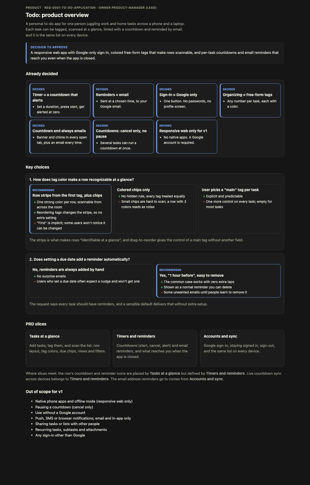

# Example: todo-app

> Run in progress. This page fills in as each loop is approved.

## The request
> Design me a to do application. The application will let users use to track their tasks. Tasks
> can categorized and organized. Tasks should be easily identifiable at a glance. Tasks should all
> have timers and reminders with it. Users should be able to retrieve tasks from any device, keep
> login very basic and minimal.

**Scope:** design only. No product code is written.

## Routing (decided by the master)
| Loop | Why | Status |
|---|---|---|
| product | lead PM overview with PRD slices, then the ticket breakdown | direction approved, breakdown in progress |
| design | "identifiable at a glance" makes the screens the heart of this request | pending |
| architecture | sync across devices, minimal auth, reminder delivery | pending |
| data-model | users, tasks, categories, timers, reminders | pending |
| infra | reminders need a scheduler, sync needs hosting | pending |
| development | skipped (design-only run) | skipped |
| retro | the first real run, so the factory should learn from it | pending |

## Product: how the direction was reached

The product loop took three passes, and the factory changed along the way. That was the point of
running a real example.

**Pass 1: a single PM wrote everything at once.** It produced three PRD pages and a 35-ticket
breakdown, and raised seven open questions. The master batched the four that changed scope into
one question to the user. The user's answers overturned three of the PM's four assumptions:

| Question | PM assumed | User decided |
|---|---|---|
| What is a timer? | tracks time spent | **a countdown that alerts** |
| Reminder channel | email | **email** |
| Sign-in | email magic link | **Google only** |
| Organizing | one category per task | **free-form tags** |

**Pass 2: a revision.** The PM rewrote the pages and cut the breakdown from 35 to 23 tickets,
because the master's size check flagged the breakdown page at 18,825 characters against a
limit of 8,000.

**Factory change.** In the design review, the user found three problems with the factory itself:
- there was no way back from a review page to the hub
- the breakdown was written before the plan was approved
- the PM should act as a lead who explains its reasoning, not one writer of many pages

That became [blueprint-labs#20](https://github.com/sahmedcse/blueprint-labs/pull/20):
- a top bar with **← Reviews** on every page
- a two-stage product loop
- a **lead PM** writing a product overview with options, pros, cons and a recommendation for
  each key choice
- one **prd-writer** subagent per slice, run in parallel
- PRDs nested under the overview as detail cards that are approved with it

**Pass 3: the lead-PM flow.** The earlier cards were withdrawn, and the lead PM wrote the overview
and a slice plan. Three writers wrote the slices in parallel. The user sent three notes on
round 1 of the overview ([round-1.json](reviews/product/overview/round-1.json)):
- always email when a countdown ends
- cancel only, no pausing
- yes to web only, to requiring a Google account, and to several countdowns at once

The lead PM revised the overview while the timers writer revised its slice at the same time.
The user approved round 2, which approved all three PRDs with it.

| Approved page | Screenshot |
|---|---|
| [Product overview](artifacts/product/overview.html) | [png](screenshots/product-overview.png) |
| [PRD: Tasks at a glance](artifacts/product/tasks-at-a-glance.html) | [png](screenshots/product-tasks-at-a-glance.png) |
| [PRD: Timers and reminders](artifacts/product/timers-and-reminders.html) | [png](screenshots/product-timers-and-reminders.png) |
| [PRD: Accounts and sync](artifacts/product/accounts-and-sync.html) | [png](screenshots/product-accounts-and-sync.png) |

The slice plan the writers worked from is [prd-plan.json](artifacts/product/prd-plan.json).
Every decision with its timestamp is in [decisions/journal.md](decisions/journal.md).
